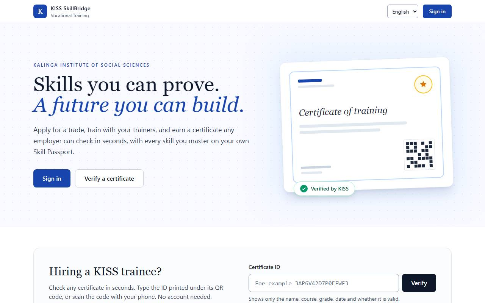
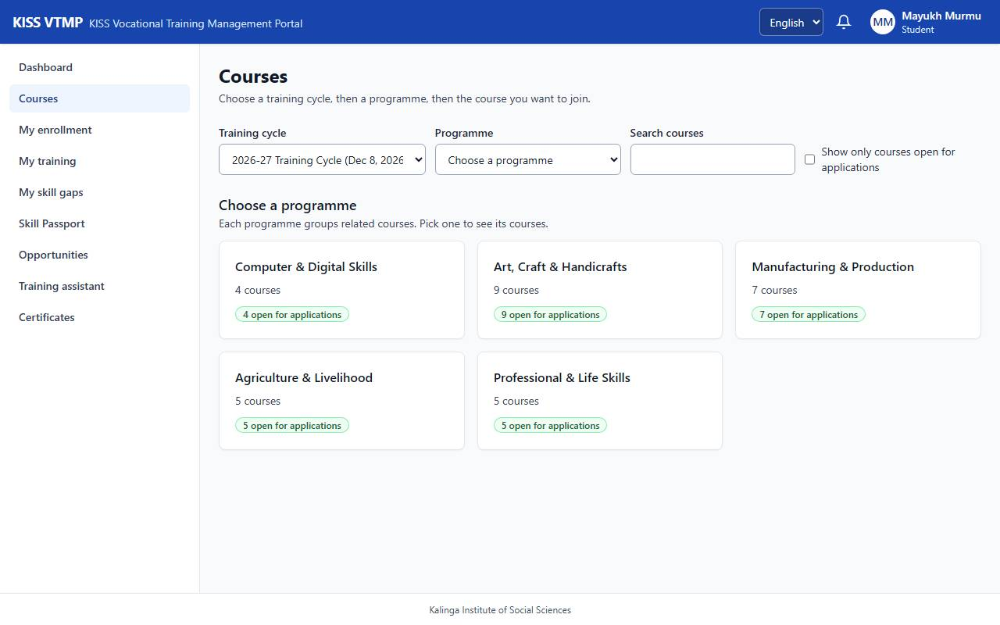
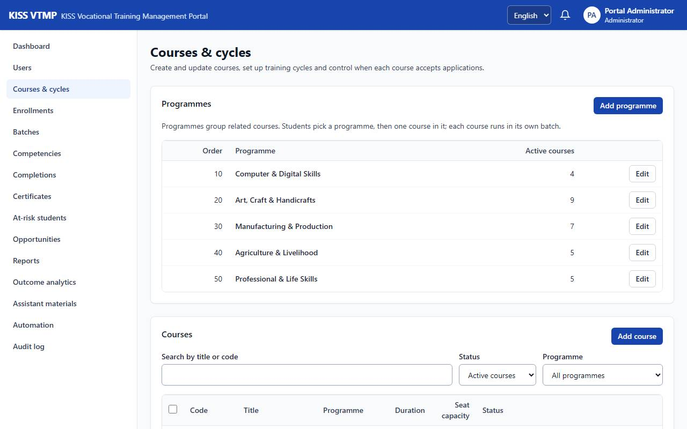
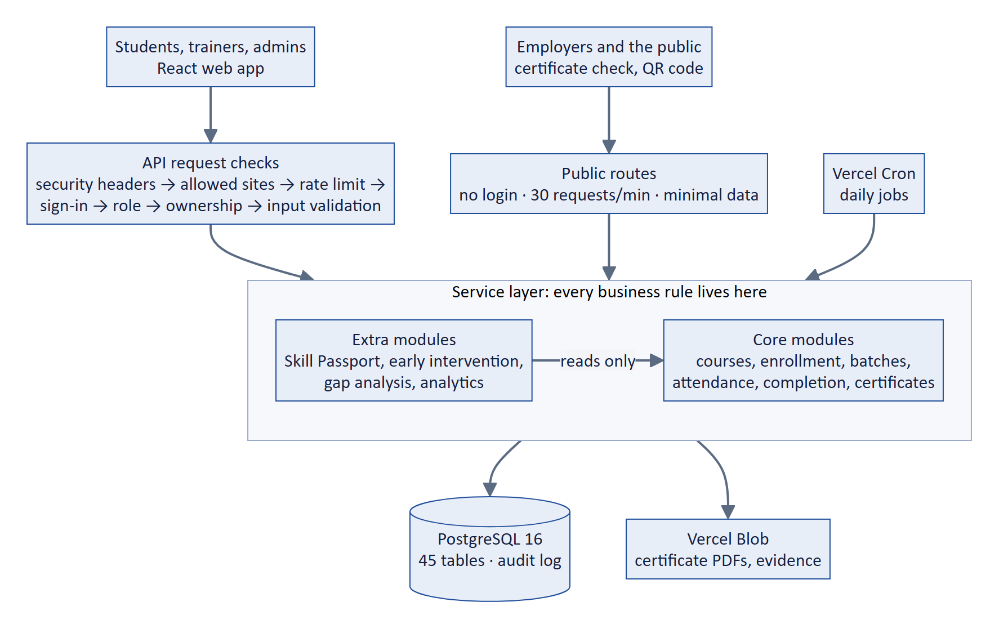

# KISS SkillBridge

**A web portal that takes every vocational student from application to a certificate anyone can
verify.** Built for the vocational training programme of the Kalinga Institute of Social Sciences
(KISS), Bhubaneswar.

**Live site:** <https://kiss-vtmp.vercel.app> · **Project report:**
[docs/PROJECT_REPORT.md](docs/PROJECT_REPORT.md) · **Presentation:**
[docs/KISS_SkillBridge_Presentation.pptx](docs/KISS_SkillBridge_Presentation.pptx)



## What it does

Vocational training at KISS used to run on paper registers and spreadsheets, and an employer had
no way to tell a real certificate from a fake one. SkillBridge replaces that with one rule-driven
workflow:

1. **Students** choose a training cycle, a programme and a course, and apply online.
2. **Admins** approve applications (or let the rules approve them) and place students in batches.
3. **Trainers** take attendance and enter marks; students see their progress as it happens.
4. **The system** decides who has completed, using the same written rules for everyone.
5. **Certificates** are issued as PDFs with a QR code that **anyone** can check in seconds.

It is open to every student: academic marks are never used to approve or rank anyone.

**Highlights:** five programmes and 30 courses · automatic approval and batch allocation · early
warnings for students who are falling behind · a Skill Passport · public QR certificate checks ·
English, Odia and Hindi · works on cheap phones over slow connections · every sensitive change in
an audit log that cannot be edited.

| Choosing a programme                                                 | Admin: programmes and courses                                       |
| -------------------------------------------------------------------- | ------------------------------------------------------------------- |
|  |  |

## How it is built



| Part     | Technology                                                                                                          |
| -------- | ------------------------------------------------------------------------------------------------------------------- |
| Web app  | React 18, Vite, Tailwind CSS, TanStack Query, i18next                                                               |
| API      | Node.js 20, Express, Zod, Prisma                                                                                    |
| Database | PostgreSQL 16                                                                                                       |
| Hosting  | Vercel and Neon, on free plans                                                                                      |
| Testing  | Jest and Supertest, Playwright and axe-core: 491 API tests and 79 browser tests, every requirement traced to a test |

## Documentation

| Document                                                              | What it covers                                          |
| --------------------------------------------------------------------- | ------------------------------------------------------- |
| [Project report](docs/PROJECT_REPORT.md)                              | The whole project in one place, with UML diagrams       |
| [User guide](docs/USER_GUIDE.md)                                      | How students, trainers and admins use the portal        |
| [Requirements (BRD)](docs/BRD.md)                                     | Business requirements and the 28 business rules         |
| [Architecture (TAD)](docs/TAD.md)                                     | Design, modules, security and deployment                |
| [Database (ER)](docs/ER.md)                                           | Tables and relationships                                |
| [Test plan](docs/TEST_PLAN.md) · [Traceability](docs/TRACEABILITY.md) | How it is tested; every requirement mapped to its tests |
| [API contract](apps/api/openapi.yaml)                                 | Every endpoint (OpenAPI)                                |

## Team

|                                                                             |                                  |
| --------------------------------------------------------------------------- | -------------------------------- |
| **Shashank Singh** ([@ShashankSinghhh](https://github.com/ShashankSinghhh)) | Design and build                 |
| **Arnav Ambasta** ([@ArnavAmbasta-05](https://github.com/ArnavAmbasta-05))  | Testing, quality and maintenance |

## Run it locally

You need Node.js 20+, pnpm 9 and Docker Desktop.

```bash
pnpm install
cp .env.example .env
pnpm db:up        # PostgreSQL in Docker
pnpm db:migrate   # create the tables
pnpm db:seed      # programmes, courses, one cycle, batches, trainers, 100 students
pnpm dev          # API on :4000, web app on :5173
```

Open <http://localhost:5173> and sign in as `admin@kiss-vtmp.test`, `trainer1@kiss-vtmp.test`
or `student001@kiss-vtmp.test` with the local password `Password@123` (local setup only).
Run the tests with `pnpm test` and `pnpm test:e2e`.
