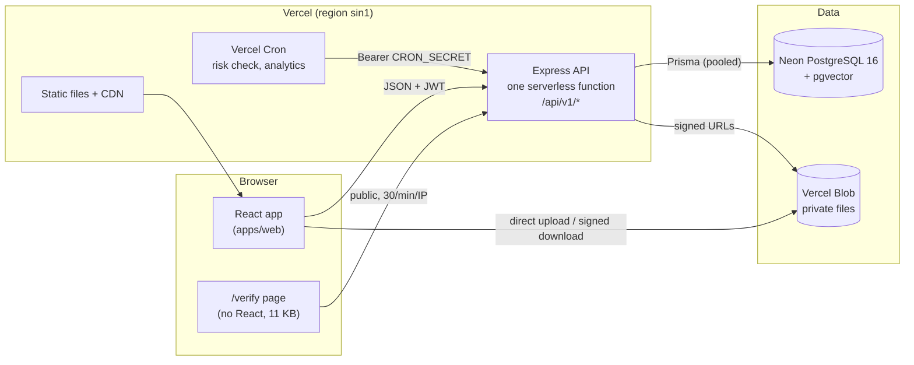

# KISS Vocational Training Management Portal (VTMP)

Takes every vocational student at KISS from enrollment to a verifiable certificate and Skill
Passport. Software Engineering project by
[@ShashankSinghhh](https://github.com/ShashankSinghhh) and
[@ArnavAmbasta-05](https://github.com/ArnavAmbasta-05).

- **Business rules:** [docs/BRD.md](docs/BRD.md) (BR-01…BR-22, BRQ-x.y, NFRs)
- **Architecture:** [docs/TAD.md](docs/TAD.md) · **Database:** [docs/ER.md](docs/ER.md)
- **Traceability:** [docs/TRACEABILITY.md](docs/TRACEABILITY.md) (every BRQ and BR → module,
  endpoint, test)
- **Testing:** [docs/TEST_PLAN.md](docs/TEST_PLAN.md) · **User guide:**
  [docs/USER_GUIDE.md](docs/USER_GUIDE.md) · **Demo script:** [docs/DEMO.md](docs/DEMO.md)
- **API contract:** [apps/api/openapi.yaml](apps/api/openapi.yaml) · Postman:
  [docs/postman/](docs/postman/kiss-vtmp.postman_collection.json)
- **Sprint log:** [docs/PROGRESS.md](docs/PROGRESS.md) · **Deployment:**
  [docs/DEPLOYMENT.md](docs/DEPLOYMENT.md) (Vercel for web + API, Neon for PostgreSQL)

## Live demo

**https://kiss-vtmp.vercel.app**

Sign in with the [seeded emails](#seed-accounts-local-development-only) (admin, trainers,
students). The live demo password is shared privately by the team: ask
[@ShashankSinghhh](https://github.com/ShashankSinghhh) or
[@ArnavAmbasta-05](https://github.com/ArnavAmbasta-05). `Password@123` works only on a local
setup.

## Architecture



Every request goes through helmet → CORS allow-list → rate limiter → authentication → role
check → ownership check → validation → controller → service. Business rules live in services
(pure rule functions in each module's `rules.ts`); every status change and its audit row are
written in one transaction. Details: [docs/TAD.md](docs/TAD.md).

The **AI training assistant** (F17) is built but switched off on the live site (no paid API
keys). To try it locally for free, set `AI_ENABLED=true`, `ASSISTANT_PROVIDER=mock` and
`AI_MONTHLY_CAP=1` in `.env`: the mock quotes the best-matching passage of the approved notes
instead of calling a model.

## Stack

| Part                       | Technology                                                          |
| -------------------------- | ------------------------------------------------------------------- |
| Web (`apps/web`)           | React 18, Vite, React Router, Tailwind CSS, TanStack Query, i18next |
| API (`apps/api`)           | Node.js 20, Express, Zod, Prisma, pino, helmet                      |
| Database                   | PostgreSQL 16 (pgvector image) via Docker                           |
| Shared (`packages/shared`) | Zod schemas, status enums and types used by both apps               |
| Tests                      | Jest + Supertest (API), Playwright + axe-core (browser)             |

## Setup

You need **Node.js 20+**, **pnpm 9** (`npm i -g pnpm@9`) and **Docker Desktop** (running).

```bash
pnpm install
cp .env.example .env        # dev defaults work as-is
pnpm db:up                  # start PostgreSQL in Docker
pnpm db:migrate             # apply migrations
pnpm db:seed                # load demo data
pnpm dev                    # API on :4000, web on :5173
```

Open http://localhost:5173 and sign in with a seed account below. The admin dashboard shows
whether the API and database are reachable, and
`GET http://localhost:4000/api/v1/health` should return `{"status":"ok","db":"ok",…}`.

### Seed accounts (local development only)

On a local setup every seeded account uses the password `Password@123`. The live demo uses the
same emails with a different, private password.

| Role    | Email                                                                          |
| ------- | ------------------------------------------------------------------------------ |
| Admin   | `admin@kiss-vtmp.test`                                                         |
| Trainer | `trainer1@kiss-vtmp.test` … `trainer4@kiss-vtmp.test`                          |
| Student | `student001@kiss-vtmp.test` … `student040@kiss-vtmp.test` (500 with `--large`) |

The seed also creates an open training cycle, three courses (Electrician — Domestic, Solar PV
Installer, Tailoring & Garment Making) with open enrollment windows, and every Setting at its
default. It is idempotent: run it again any time. `pnpm db:seed --large` adds students up to
500 for the allocation timing test. Database tables are described in [docs/ER.md](docs/ER.md). `--reset-passwords` (with `SEED_PASSWORD`) sets a new password on every seeded account.

Sign in at http://localhost:5173 with any seed account: each role lands on its own dashboard
(`/student`, `/trainer`, `/admin`).

## Scripts

| Command                                        | What it does                                         |
| ---------------------------------------------- | ---------------------------------------------------- |
| `pnpm dev`                                     | Run API and web together with hot reload             |
| `pnpm db:up` / `pnpm db:down`                  | Start / stop the PostgreSQL container                |
| `pnpm db:migrate`                              | Create and apply Prisma migrations (dev)             |
| `pnpm db:seed`                                 | Load seed data                                       |
| `pnpm test`                                    | All API tests (unit + integration; needs `db:up`)    |
| `pnpm test:unit`                               | API unit tests only (no database needed)             |
| `pnpm test:e2e`                                | Playwright browser tests (starts the web dev server) |
| `pnpm lint` / `pnpm typecheck` / `pnpm format` | Code quality                                         |
| `pnpm build`                                   | Production builds of API and web                     |
| `pnpm --filter @vtmp/web i18n:sync`            | Copy new English UI keys into the Odia/Hindi files   |
| `pnpm --filter @vtmp/web i18n:check`           | Fail if any Odia/Hindi string is missing or empty    |
| `pnpm --filter @vtmp/web bundle:check`         | Fail if a core student page is over 500 KB (gzip)    |
| `pnpm docs:trace` / `pnpm docs:check`          | Rebuild / verify docs/TRACEABILITY.md                |
| `node scripts/postman.mjs`                     | Rebuild the Postman collection from openapi.yaml     |

Run Playwright once with `pnpm --filter @vtmp/web exec playwright install chromium` before the
first `pnpm test:e2e`.

GitHub Actions also has three workflows you start by hand: **Performance** (`perf.yml`: k6 with
100 users and Lighthouse on a production build), and **Gate 1** / **Gate 2 on the live site**
(the release acceptance tests against the deployed URL).

## Repository layout

```
apps/api/src/core/      config, errors, http, middleware, db, audit, settings (shared kernel)
apps/api/src/modules/   one folder per module: routes, controller, service, schema, __tests__
apps/web/src/           components/ui (design system), features/<module>, locales/{en,or,hi}
packages/shared/src/    enums, schemas, types shared by API and web
prisma/                 schema.prisma, migrations, seed.ts
docs/                   BRD, TAD, ER, traceability, test plan, user guide, demo, progress log
perf/                   k6 load test and Lighthouse budget check
scripts/                Vercel build, traceability and Postman generators
```

## Working together

- `main` is the deployed branch; work on a feature branch and open a pull request.
- CI (GitHub Actions) runs lint, typecheck, unit tests, integration tests against PostgreSQL,
  the production build and the browser smoke tests on every push and pull request.
- UI text never goes in components: add keys to `apps/web/src/locales/en/*.json` and use `t()`.
- Never commit `.env` or real secrets.
