# KISS SkillBridge: Project Report

**A web portal that takes every vocational student from application to a certificate anyone can
verify**

| | |
| --- | --- |
| **Team** | **Shashank Singh** ([@ShashankSinghhh](https://github.com/ShashankSinghhh)) · **Arnav Ambasta** ([@ArnavAmbasta-05](https://github.com/ArnavAmbasta-05)) |
| **For** | Kalinga Institute of Social Sciences (KISS), Bhubaneswar: vocational training programme |
| **Live system** | <https://kiss-vtmp.vercel.app> |
| **Source code** | <https://github.com/ShashankSinghhh/kiss-vocational-training> |
| **Version** | Final report, November 2026 |

## Contents

1. [Abstract](#1-abstract)
2. [Introduction](#2-introduction)
3. [Existing system and proposed system](#3-existing-system-and-proposed-system)
4. [Requirements](#4-requirements)
5. [System design](#5-system-design)
6. [UML diagrams](#6-uml-diagrams)
7. [Implementation](#7-implementation)
8. [User interface](#8-user-interface)
9. [Testing](#9-testing)
10. [Quality assurance and security](#10-quality-assurance-and-security)
11. [Project management](#11-project-management)
12. [Deployment and maintenance](#12-deployment-and-maintenance)
13. [Results, limitations and future work](#13-results-limitations-and-future-work)
14. [Conclusion](#14-conclusion)
15. [References and related documents](#15-references-and-related-documents)
16. [Appendix: running the project](#16-appendix-running-the-project)

## 1. Abstract

KISS trains tribal students in vocational trades, but applications, batches, attendance, marks
and certificates were kept on paper and in spreadsheets, and an employer had no way to tell a
real certificate from a fake one. **KISS SkillBridge** replaces that with one web portal for
students, trainers, administrators and employers. Students choose a programme and a course and
apply; the system approves applications by rule, places students in batches, records attendance
and marks, decides who has completed using numbered business rules, and issues a PDF certificate
with a QR code that anyone can check in seconds. Every sensitive change is audited.

The system was built by a team of two in 14 sprints across three releases, then improved
through three review rounds. It has about 39,000 lines of TypeScript, 45 database tables and 26
modules. All 491 API tests and 79 browser tests pass, every one of the 120 requirements and
business rules is traced to a test, and the portal runs live on free hosting in English, Odia and
Hindi.

## 2. Introduction

### 2.1 Background

KISS runs a vocational programme in five areas: computer and digital skills, traditional crafts,
manufacturing, agriculture, and professional and life skills. Each training cycle, students apply
for a course, are placed in a batch with a trainer, attend sessions, are assessed and, if they
meet the rules, receive a certificate.

### 2.2 Problem statement

| # | Problem | Impact |
| --- | --- | --- |
| P1 | Enrollment and batch allocation done by hand, with no view of seats | Over-filled batches, unfair placement, admin hours lost each cycle |
| P2 | Attendance and marks scattered across registers | Eligibility checks are slow and differ between trainers |
| P3 | Students cannot see their attendance or results | Problems are found only at the end of the course |
| P4 | Certificates issued without a consistent eligibility or authenticity check | Certificates carry little weight with employers; forgery risk |
| P5 | No record of who changed attendance or marks | Disputes cannot be resolved |

### 2.3 Objectives

Success means one student can travel the whole path from enrollment to a verified certificate
with no offline step.

- Digitize all 12 stages of the training workflow.
- Give each role (student, trainer, admin) its own screens, with every permission checked on the
  server.
- Compute allocation and attendance automatically: an allocation preview for 500 students in
  under 5 seconds.
- Issue certificates only to eligible students, each with a unique ID and a QR code that anyone
  can check in under 3 seconds.
- Flag struggling students within one day of a warning sign.
- Log every sensitive change with its old and new value.
- Work on cheap phones over slow connections, in English, Odia and Hindi, at zero running cost.

### 2.4 Scope

**In scope:** sign-in and roles; programmes, courses and training cycles; applications and
approval; batch allocation; sessions and attendance; assessments and marks; completion and
certificates; reports and dashboards; notifications; the Skill Passport, early intervention,
skill gap analysis and public certificate verification.

Vocational training is open to every student: the system does not record or use academic
marks (CGPA) to approve, allocate or rank anyone.

**Out of scope:** fees and payments, payroll, hosting course content, biometric attendance and
native mobile apps.

## 3. Existing system and proposed system

| Area | Existing (paper and spreadsheets) | Proposed (KISS SkillBridge) |
| --- | --- | --- |
| Applications | Paper forms, collected by hand | Online: cycle → programme → course; one application per cycle; automatic approval by rule |
| Allocation | Done by hand, seats unclear | Preview, then confirm: by preference, priority rule and batch capacity; overflow waitlisted |
| Attendance and marks | Registers kept by each trainer | Entered once per session; editable for 48 hours, then only by an admin with a reason |
| Progress | Students find out at the end | Students see attendance, marks and status as soon as they are entered |
| Completion | Judged case by case | Decided by numbered rules (BR-09), the same for everyone |
| Certificates | Printed, cannot be verified | PDF with a unique code and QR; anyone can verify online without an account |
| Accountability | No record of changes | Every change in an audit log the database prevents from being edited |

## 4. Requirements

The full requirements are in the [Business Requirements Document](BRD.md): 20 features, 28
business rules and 14 quality requirements, each with an ID that the code and tests refer to.

### 4.1 Users

| User | What they do |
| --- | --- |
| Student | Choose a training cycle, a programme and a course; apply; track or withdraw the application; see their training, attendance and results; download the certificate; share a Skill Passport |
| Trainer | See their batches; take attendance; enter marks; evaluate and recommend students; act on at-risk alerts |
| Admin | Manage users, programmes, courses and cycles; approve applications (or let the rules approve them); run batch allocation; schedule sessions; approve completion; revoke certificates; see reports and the audit log |
| Employer / public | Check a certificate by its ID or QR code, without signing in |

### 4.2 Functional requirements

| Feature | Main requirements |
| --- | --- |
| F1 Sign-in and roles | Secure sign-in; each role sees only its own screens, enforced on the server; profile and password change |
| F2 Courses | Admin manages programmes, courses and cycles; opens an enrollment window per course per cycle |
| F3 Enrollment | Students browse and apply; one active application per cycle; admin approves, waitlists or rejects; automatic approval by rule |
| F4 Batches | Admin creates batches; the system allocates approved students by preference and priority, with a preview; trainers assigned; sessions scheduled |
| F5 Attendance | Trainers mark present, absent or late per session, for their own batches only; edits limited after 48 hours |
| F6 Assessments | Marks validated between 0 and the maximum; progress milestones and a final evaluation |
| F7 Certificates | The system checks completion eligibility; admin approves; a PDF certificate with QR code is issued |
| F8 Reports | Batch-wise and course-wise reports with completion rates, exportable as CSV or PDF |
| F9 Dashboards | Each role has a dashboard with its key counts and alerts |
| F10–F20 | Skill Passport, early intervention, skill gap analysis, QR verification, scheduling advice, multilingual UI, practical evidence, career matching, audit viewer, outcome analytics, an AI training assistant (built, switched off) |

### 4.3 Key business rules

| Rule | What it says |
| --- | --- |
| BR-01 | One active application per student per training cycle |
| BR-02 | Applications only while the course's enrollment window is open |
| BR-03 | A batch never goes over capacity; extra approved students are waitlisted |
| BR-04 | Allocation follows preference rank, then submission time; academic marks are never used |
| BR-05 | Trainers act only on batches assigned to them |
| BR-06 | Attendance can be changed for 48 hours, then only by an admin with a reason |
| BR-08 | Attendance % = sessions attended ÷ sessions held × 100, to two decimals |
| BR-09 | Completion needs attendance ≥ 75 %, every ended session marked, all mandatory assessments, an aggregate ≥ 40 % and the trainer's recommendation |
| BR-10 | A certificate only after admin approval, with a unique, unguessable ID |
| BR-11 | Grades: A ≥ 85 %, B 70–84.99 %, C 55–69.99 %, D 40–54.99 % |
| BR-12 | Every change to attendance, marks, applications or completion is logged |
| BR-15 | The public certificate check never shows marks, attendance or contact details |

These limits (75 %, 40 %, 48 hours and so on) are settings an admin can change, not numbers
fixed in the code.

**Decision table: can a student complete? (BR-09)**

| Condition | R1 | R2 | R3 | R4 | R5 | R6 |
| --- | --- | --- | --- | --- | --- | --- |
| Attendance ≥ 75 % | Y | N | – | – | – | – |
| Every ended session marked | Y | – | N | – | – | – |
| All mandatory marks in | Y | – | – | N | – | – |
| Aggregate ≥ 40 % | Y | – | – | – | N | – |
| Trainer recommends | Y | – | – | – | – | N |
| **Eligible?** | **Yes** | No | No | No | No | No |

### 4.4 Quality requirements

| ID | Area | Requirement |
| --- | --- | --- |
| NFR-01 | Security | Passwords hashed; expiring sign-in tokens; every request authorised on the server |
| NFR-03 | Performance | Common pages and APIs within 2 s for 100 users at once |
| NFR-04 | Usability | Works on desktop and phone; each core task within three clicks of the dashboard |
| NFR-05 | Reliability | Status changes are all-or-nothing (database transactions) |
| NFR-06 | Auditability | Sensitive changes logged in an insert-only table |
| NFR-09 | Public access | Certificate check loads within 3 s on a phone, no sign-in |
| NFR-10 | Low bandwidth | Core student pages under 500 KB |
| NFR-11 | Languages | No text fixed in the code; Odia and Hindi added without code changes |
| NFR-12 | Accessibility | Keyboard use, labelled fields, WCAG 2.1 AA contrast |

## 5. System design

The full architecture is in the [Technical Architecture Document](TAD.md).

### 5.1 Architecture

SkillBridge is a **modular monolith**: one web app, one API and one database, with every business
rule kept in one layer of the API.

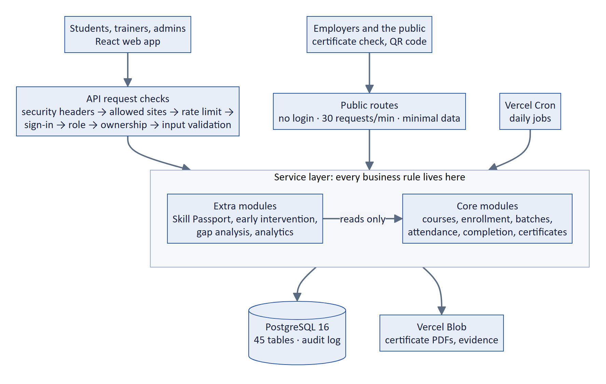

### 5.2 Design principles

| Principle | In the code |
| --- | --- |
| High cohesion | One module per business area (enrollments, batches, completion, passport…), 26 in all; each owns its routes, service, rules and tests |
| Low coupling | Modules call only each other's service functions, never each other's tables; core modules never depend on the extra ones (a test checks it) |
| Separation of concerns | Business rules only in services; pure rule functions (attendance %, grade, eligibility, risk level) tested at their exact limits |
| Information hiding | Public pages return only name, course, grade, date and status (BR-15) |
| Configuration over code | 50 thresholds and switches in a Settings table, changed by the admin and audited |
| All-or-nothing changes | Each status change and its audit record are saved in one transaction |

### 5.3 Database design

The database has 45 tables, created by 16 versioned migrations. The core: a **Programme** groups
**Courses**; a **Training cycle** offers courses through **Course offerings** (enrollment
windows); a student's **Enrollment** names a course; a **Batch** runs one course in one cycle,
with its students, trainers, **Sessions** (attendance) and **Assessments** (marks); a
**Certificate** records the result and carries the public code for the QR. The **Audit log** is
insert-only: a database trigger blocks any update or delete. The full entity-relationship model
is in [ER.md](ER.md); the class diagrams in Section 6.2 show the core entities.

### 5.4 Technology choices

| Layer | Technology | Why |
| --- | --- | --- |
| Language | TypeScript, shared Zod schemas | One language; browser and server check data the same way |
| Web app | React 18, Vite, Tailwind CSS, TanStack Query | Pages load on demand for slow phones; consistent design |
| Languages | i18next, Noto fonts on demand | Odia and Hindi without code changes; small pages |
| API | Node.js 20, Express | Long-term support; runs as a serverless function |
| Data | PostgreSQL 16, Prisma | Constraints and transactions protect the rules; versioned schema |
| Security | JWT + httpOnly cookie, bcrypt, helmet | Stateless sign-in; tokens out of reach of page scripts |
| Certificates | PDFKit and qrcode on the server | Cannot be altered in the browser |
| Hosting | Vercel, Neon, Vercel Blob, Vercel Cron | Free, no server to maintain, deploys on every merge |

## 6. UML diagrams

### 6.1 Use case diagram

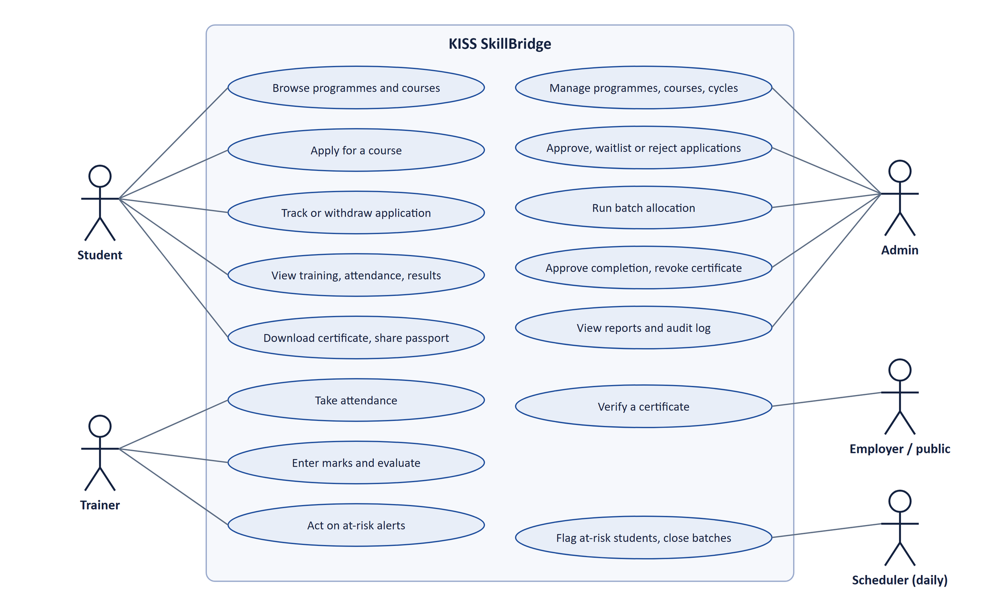

### 6.2 Class diagrams

The domain model, in two parts. **Applying for a course:** users, students, programmes, courses,
cycles and applications.

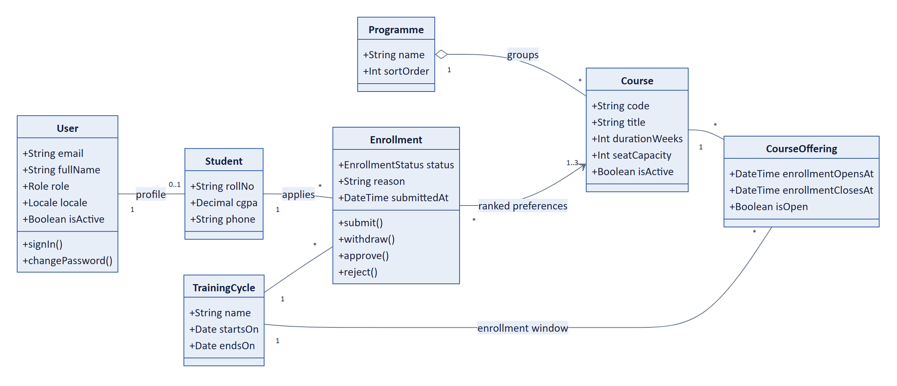

**Training and results:** batches, trainers, sessions, attendance, assessments, results and
certificates. A filled diamond is composition (a session's attendance has no meaning without the
session); a hollow diamond is aggregation.

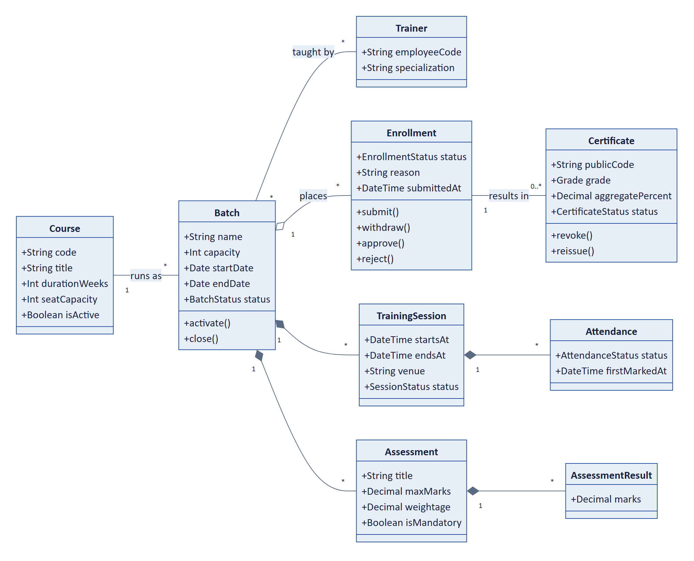

### 6.3 Sequence diagrams

**A student applies for a course,** approved at once when automatic approval is on and every rule
is met:

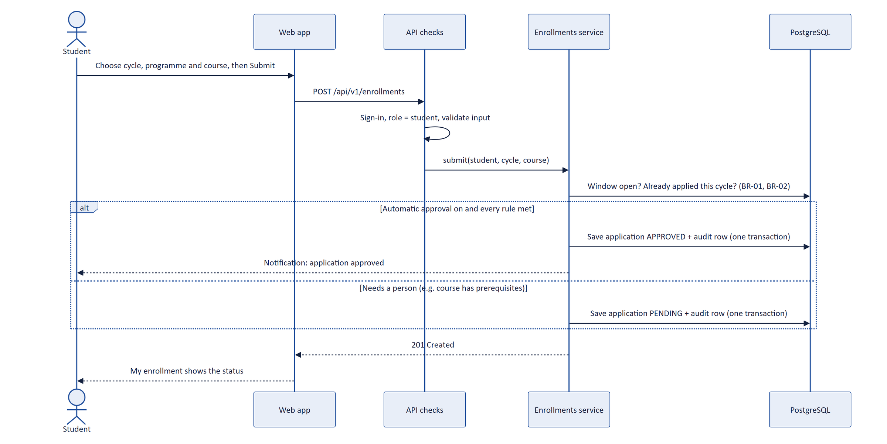

**An employer verifies a certificate,** with no account:

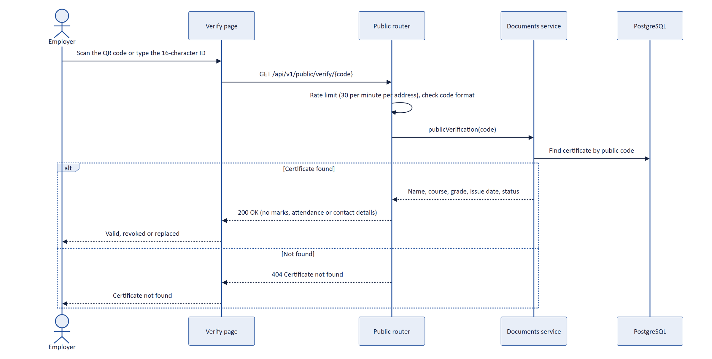

### 6.4 Activity diagram: completing a student

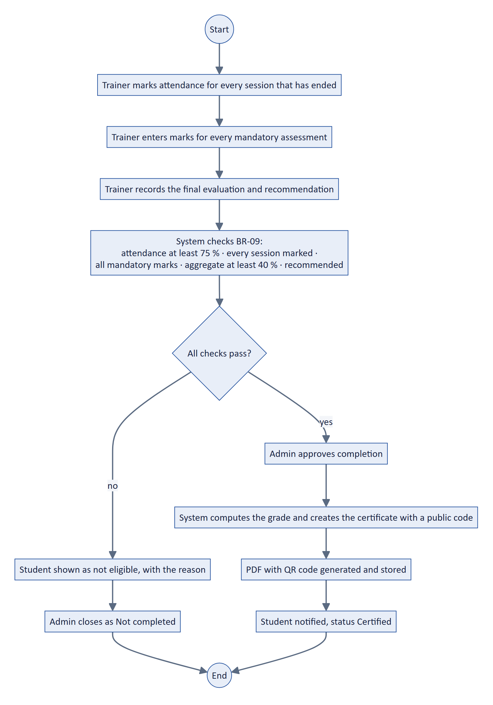

### 6.5 State diagram: life of an application

Every application moves only along these transitions; any other move is refused by the API with
`409 INVALID_STATUS_TRANSITION`.

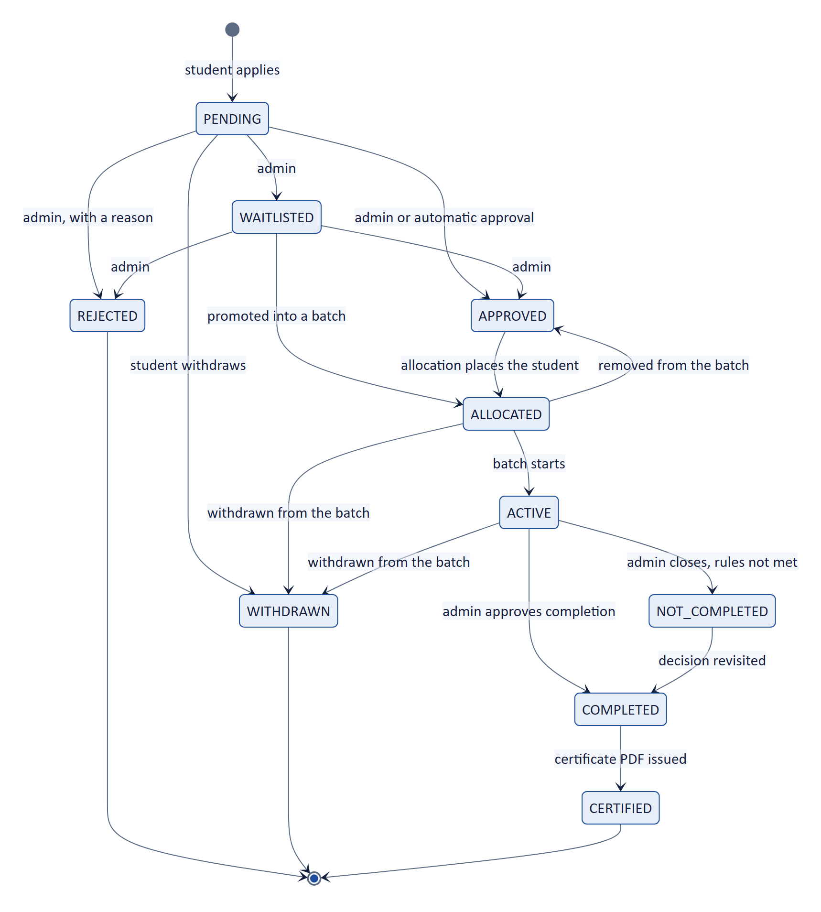

### 6.6 Deployment diagram

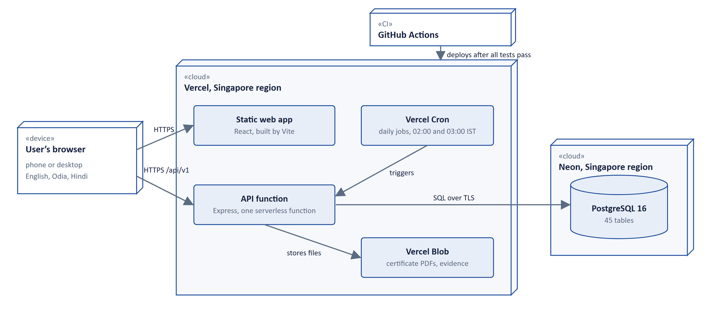

## 7. Implementation

### 7.1 Project structure

```text
apps/api/src/modules/<module>/   routes, controller, service, schema, rules.ts, tests
apps/api/src/core/               request pipeline, database, audit, settings, errors, config
apps/web/src/features/<module>/  screens for each module
apps/web/src/locales/{en,or,hi}/ all user-facing text, per language
packages/shared/src/             Zod schemas, status enums and types used by both apps
prisma/                          schema, 16 migrations, seed
```

### 7.2 The request pipeline

Every request passes the same chain before any business rule runs: security headers (helmet) →
allowed sites (CORS) → rate limiter → sign-in check → role check → ownership check (a trainer only
for their own batches, a student only for their own records) → input validation (Zod) →
controller → service. Ownership failures return 403; invalid input returns 422; every error has
the same shape, `{ "error": { "code", "message" } }`.

### 7.3 Key algorithms

- **Allocation (BR-03, BR-04):** approved applicants are sorted by preference rank, then by the
  submission time. Academic marks are never used. Each is placed in the first batch of their course with
  a free seat; the rest are waitlisted. The admin sees a preview first, and nothing changes until
  they confirm.
- **Attendance and eligibility (BR-08, BR-09):** attendance % is computed on read, never stored.
  Eligibility runs the five checks of the decision table in Section 4.3; the grade comes from the
  aggregate (BR-11).
- **Early intervention:** a daily job rates each student's risk from attendance, consecutive
  absences and marks (for example, Medium below 80 % attendance, High below 75 %) and alerts the
  trainer, with the reason, while there is still time to act.
- **Automatic approval:** an application that meets the admin's saved rules (no prerequisites
  needing review) is approved in the same transaction that saves it, and the
  student is told at once.
- **Certificate codes:** each certificate gets a random 16-character public code; the QR code
  links to the public verify page.

### 7.4 Size

About **38.9 thousand lines of product code** plus 11.9 thousand lines of tests (non-blank
lines), in 2,521 functions with an average cyclomatic complexity of 1.67. The API has 26 modules
and the database 45 tables.

## 8. User interface

The interface is the same on a phone and a desktop, in English, Odia and Hindi.

**Public front page**

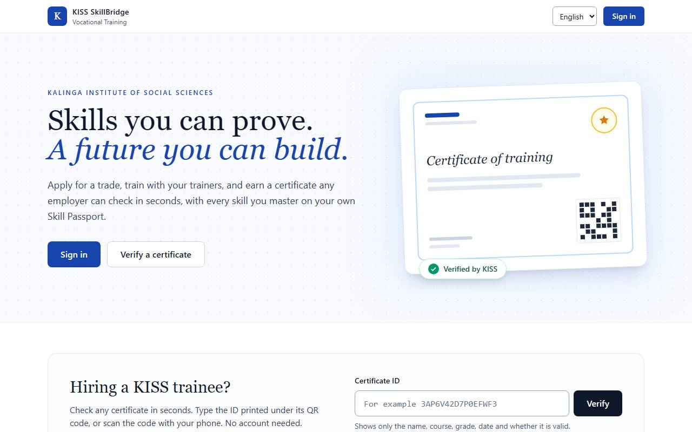

**Student: choose a programme, then a course**

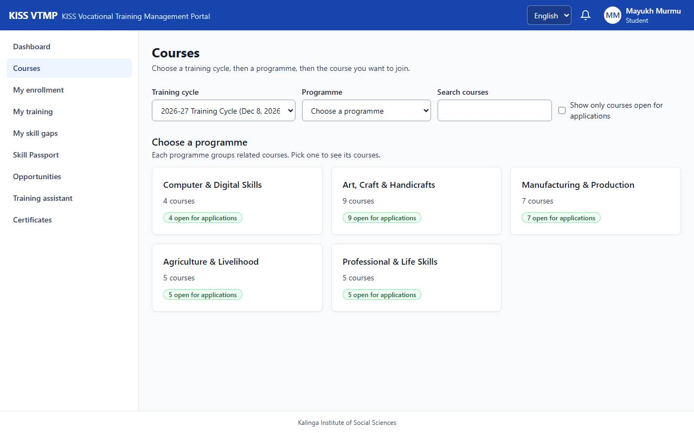

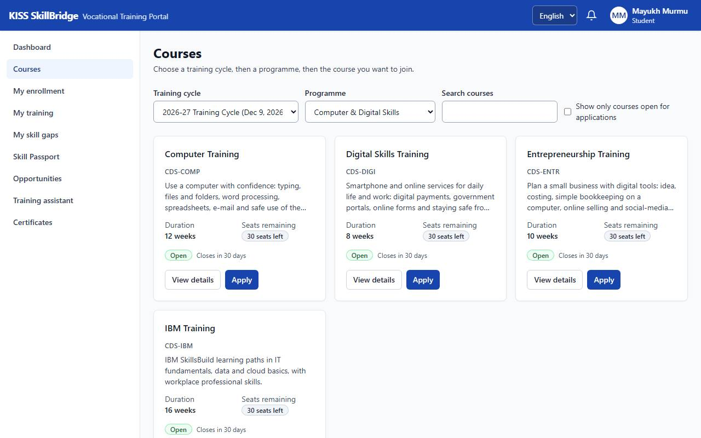

**Student: apply for one course**

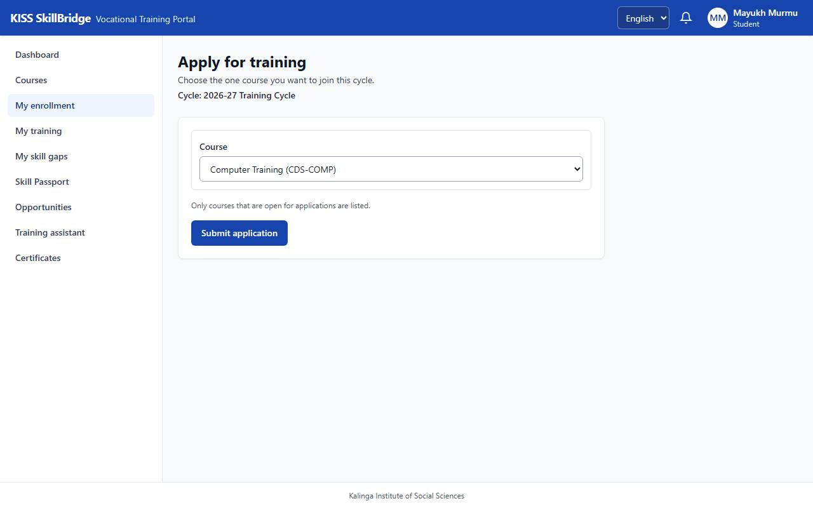

**Admin: programmes and courses**

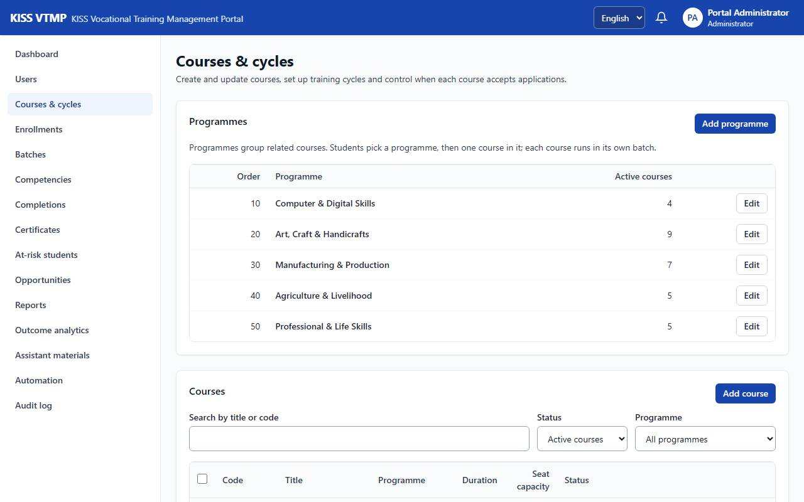

**Admin: batches, one per course, each with its trainer**

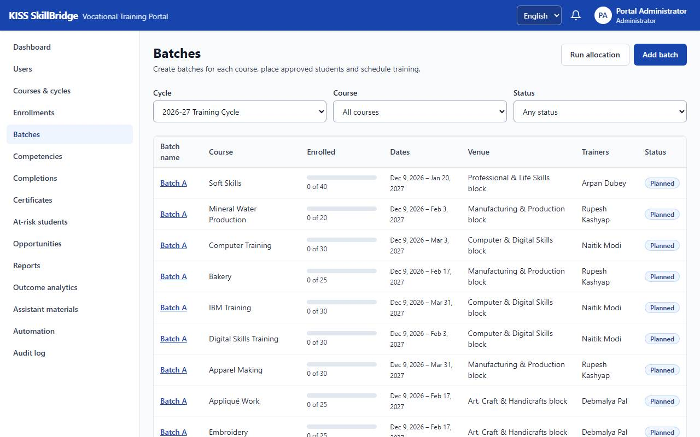

**On a phone**

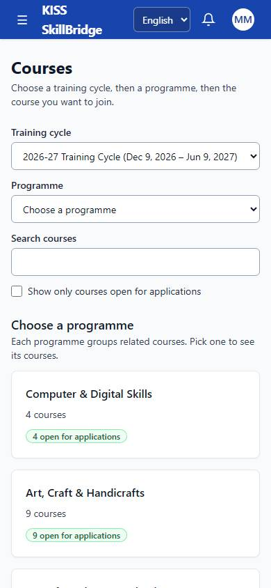

More screens, role by role, are in the [user guide](USER_GUIDE.md).

## 9. Testing

All 491 API tests and 79 browser tests pass, and every one of the 120 requirements and business
rules is covered by at least one test ([TRACEABILITY.md](TRACEABILITY.md)). The test plan is in
[TEST_PLAN.md](TEST_PLAN.md).

### 9.1 Strategy

| Level | Tool | What it proves |
| --- | --- | --- |
| Unit (white box) | Jest | Rule functions at their limits: attendance 74.99 vs 75.00 %, aggregate 39.99 vs 40.00 %, grade bands, risk levels, allocation order |
| Integration | Jest + Supertest | Every endpoint against a real PostgreSQL: checks, transactions, audit rows, database triggers |
| System (black box) | Playwright | Whole journeys on a desktop and a phone, from application to certificate |
| Acceptance | Gate 1 and Gate 2 | The release journeys, run against the live site |
| Regression | GitHub Actions | All of it on every push and pull request |
| Security | Route suite | Who may call each route: missing sign-in, wrong role and other users' data all refused |
| Accessibility | axe-core | Every page of every role: no serious issue; attendance done with the keyboard only |
| Performance | k6, Lighthouse | 100 users at once; the certificate check on a slow phone connection |

**Test drivers and stubs:** each test creates its own data through fixtures; the AI assistant and
file storage run on mock providers, so no test calls a paid service.

### 9.2 Results

| Result | Value |
| --- | --- |
| API tests | 491 in 59 files, all passing |
| Browser tests (desktop and phone) | 79 in 16 files, all passing |
| Code covered by API tests | about 90 % of lines |
| Accessibility | 0 serious or critical issues on any page |
| Certificate check page on a phone | Lighthouse score 100, loads in 0.9 s, 11 KB |
| Live site response | 0.4–0.6 s; 2.7 s for the first request after it has been idle |

Before submission we also clicked through every page as each user, in English, Odia and phone
size (95 page visits), and ran a full back-and-forth journey on the real course data. It found
one problem (a duplicate programme name showed a vague error), which we fixed the same day.

## 10. Quality assurance and security

### 10.1 Review rounds after release

| Round | Kind | Found | Outcome |
| --- | --- | --- | --- |
| 1 | Validation: a test run of the live site in every role | 22 findings | 20 fixed; 2 shown not to be defects |
| 2 | Verification: the rules checked against real cases | 8 logic gaps, 9 manual steps | 2 rules amended, 6 new rules (BR-23…BR-28), 9 steps automated |
| 3 | Security: 51 attacks on the running API, code review, dependency audit | 3 medium, 4 low | All fixed |

Every fix ships with a test that fails on the old code, and requirements are amended in the BRD
before the code changes.

### 10.2 Quality practices

- Every change goes through the same checks: strict TypeScript, lint with no warnings, all tests,
  the translation and traceability checks, the production build and a page-size budget.
- Code reviewed through pull requests.
- Requirements, design and test documents versioned with the code (BRD and TAD v1.0 → v1.2,
  [CHANGELOG.md](internal/CHANGELOG.md)).

### 10.3 Security

- Passwords stored hashed (bcrypt); short-lived sign-in tokens; refresh token in an httpOnly
  cookie; an account locks after 5 wrong passwords; a separate admin password.
- Role and ownership checked on the server for every request; the security suite proves it for
  every route.
- Public pages show the minimum and are rate-limited (30 requests per minute per address).
- Security headers on every page; no secrets in the code.
- Every sensitive change in an audit log the database itself prevents from being edited.

## 11. Project management

### 11.1 Process model

We used an **iterative and incremental** model with a written plan first: the requirements and
architecture documents were written and reviewed, then the system was built in 14 short sprints
grouped into three releases, each closed by an acceptance gate.

- **Not waterfall:** the client's real needs (programmes, automatic approval) only showed once
  they used the system.
- **Not pure agile:** rules about certificates carry weight, so they were numbered first and
  change only by a BRD amendment.

Every sprint ended with the same definition of done: lint, type check and all tests pass; new
endpoints documented; demo data updated; all text translatable; and an entry in the sprint log
([PROGRESS.md](internal/PROGRESS.md)).

### 11.2 Timeline

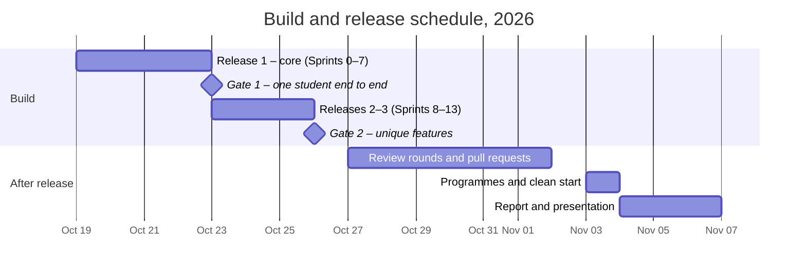

| Phase | What was delivered |
| --- | --- |
| Release 1 (Sprints 0–7) | Project set-up and CI; database and audit log; sign-in and roles; courses and enrollment; batches and allocation; attendance and marks; completion and certificates; reports. **Gate 1** passed on 23 Oct 2026 |
| Release 2 (Sprints 8–10) | Skill model and gap analysis; Skill Passport and QR verification; early intervention and the audit viewer. **Gate 2** passed on 26 Oct 2026 |
| Release 3 (Sprints 11–13) | Scheduling advice, practical evidence, career matching, three languages, outcome analytics, AI assistant; hardening |
| Review rounds (27 Oct – 2 Nov) | The three rounds in Section 10.1, through pull requests #1–#11 |
| Final changes (3–4 Nov) | Programmes, a clean database, the public front page and the name KISS SkillBridge |

### 11.3 Team and contributions

| | **Shashank Singh** | **Arnav Ambasta** |
| --- | --- | --- |
| Role | Design and original build; repository owner | Testing, maintenance and documentation |
| Documents | Project documentation, BRD and TAD v1.0 | BRD and TAD v1.1 and v1.2, changelog, test plan |
| Build | Sprints 0–13: core workflow to certificates, Skill Passport, early intervention, scheduling, evidence, career matching, languages, analytics, AI assistant | Password recovery, withdrawal, closing batches, automation of nine admin steps, CSV student import |
| Quality | Security suite, traceability check, Gates 1 and 2, deployment | Site test run, logic review, security assessment; every finding fixed with a test |
| Later work | Programmes, clean seed, front page; merged pull requests #1–#11 | Lockout race fix, security headers, dependency and search fixes, separate admin password |

### 11.4 Risk management

| Risk | What happened | Mitigation that worked |
| --- | --- | --- |
| Scope growth | 20 features instead of the minimum 9 | Minimum product frozen and shipped first (Gate 1); the rest in later releases |
| Security gaps | None in role or ownership checks | A suite over every route; the later attack test found only lockout and header gaps, now fixed |
| Testing time | Avoided | Tests written with each feature (definition of done) |
| Deployment | A host required a payment card | API moved to Vercel in Sprint 2; redeployed on every merge |
| Zero budget | No paid AI keys | AI assistant built with mock providers, switched off on the live site |
| Working from a fork (new) | Merge conflicts, no CI secrets | Merge main before each pull request; one repository with write access |

### 11.5 Metrics and estimation

| Measure | Value |
| --- | --- |
| Size | 38.9 KLOC of product code, 11.9 KLOC of tests |
| Function points | about 1,066 (996 unadjusted; value adjustment factor 1.07) |
| Average cyclomatic complexity | 1.67 over 2,521 functions |
| Basic COCOMO (organic) estimate | 112 person-months, 15 months, 7.5 people on average |
| Actual | 2 people, about 3 weeks of building, with an AI coding assistant |

COCOMO's 1981 constants assume hand-written code. With modern frameworks and an AI coding
assistant, size measures still describe the product, but effort models need recalibrating.

## 12. Deployment and maintenance

### 12.1 Deployment

| Part | Where it runs |
| --- | --- |
| Web app and API | Vercel, Singapore region (static files plus one serverless function) |
| Database | Neon PostgreSQL 16, Singapore region |
| Certificate PDFs and evidence files | Vercel Blob |
| Daily jobs (risk check at 02:00 IST; reminders and closing finished batches at 03:00 IST) | Vercel Cron |

Every push to the main branch is tested and then deployed automatically; the database migration
runs as part of the build. Because the API is serverless, nothing is kept in memory between
requests: rate limits live in the database and scheduled jobs take a database lock. The running
cost is zero. The live database starts clean: 5 programmes, 30 courses, one training cycle open
for applications, one batch per course with its trainer, and 100 students. See
[DEPLOYMENT.md](internal/DEPLOYMENT.md).

### 12.2 Maintenance after release

| Kind | Examples |
| --- | --- |
| Corrective | Unmarked sessions inflated attendance (now every ended session must be marked); 20 wrong passwords sent at once never locked the account (now counted atomically); a vague error for duplicate programme names |
| Adaptive | API moved to serverless hosting; rate limits kept in the database; jobs on a cloud scheduler |
| Perfective | Automation of nine admin steps, CSV student import, programmes, students choosing their own cycle, the public front page |
| Preventive | Browser security headers, a dependency update, search escaping, a separate admin password |

Each change follows the same path: BRD amendment → code → a test that fails on the old code →
pull request.

## 13. Results, limitations and future work

### 13.1 Results

The full enrollment-to-certificate workflow, the Skill Passport, early intervention, skill gap
analysis, QR verification, three languages and phone support are live at
<https://kiss-vtmp.vercel.app>, with all tests passing and every requirement traced.

### 13.2 Limitations

- The first request after the site has been idle takes about 2.7 s (free hosting), above the 2 s
  target.
- The Odia and Hindi text was drafted by machine and still needs a native speaker's review.
- The AI training assistant is built and tested but switched off, because it needs a paid key.

### 13.3 Future work

| When | What |
| --- | --- |
| Next: go-live | Load KISS's real students (CSV import is ready); native-speaker Odia and Hindi review; backups, monitoring and a data protection review; a second admin |
| Soon: next term | SMS or WhatsApp notices; paid hosting without the cold start; switch on the AI assistant; two-factor sign-in for admins; offline attendance |
| Later: growth | Digitally signed certificates; national-system integration if KISS wants it; an employer portal; an Android app; more campuses on one portal |

## 14. Conclusion

KISS SkillBridge turns a paper-based process into one clear, audited workflow: students see their
progress as it happens, trainers record it once, the system applies the rules the same way for
everyone, and every certificate can be checked by anyone in seconds. Writing every rule down
first, keeping the rules in one place, testing each one at its limits and reviewing every change
are what let a team of two deliver a system of this size that works correctly.

## 15. References and related documents

1. R. S. Pressman, *Software Engineering: A Practitioner's Approach*, 8th ed., McGraw Hill.
2. Rajib Mall, *Fundamentals of Software Engineering*, 5th ed., PHI Learning.
3. Pankaj Jalote, *Software Project Management in Practice*, Pearson Education.
4. IEEE Std 830-1998, *Recommended Practice for Software Requirements Specifications*.

**Project documents:** [User guide](USER_GUIDE.md) · [Demo script](internal/DEMO.md) ·
[Requirements (BRD)](BRD.md) · [Architecture (TAD)](TAD.md) · [Database (ER)](ER.md) ·
[Test plan](TEST_PLAN.md) · [Traceability](TRACEABILITY.md) · [Deployment](internal/DEPLOYMENT.md) ·
[Changelog](internal/CHANGELOG.md) · [Sprint log](internal/PROGRESS.md) ·
[API contract](../apps/api/openapi.yaml) · [Presentation](KISS_SkillBridge_Presentation.pptx)

## 16. Appendix: running the project

```bash
pnpm install          # install everything
pnpm db:up            # PostgreSQL 16 in Docker
pnpm db:migrate       # create the tables
pnpm db:seed          # programmes, courses, one cycle, batches, trainers, 100 students
pnpm dev              # API on :4000, web app on :5173
```

```bash
pnpm test             # API unit and integration tests
pnpm test:e2e         # browser tests
pnpm lint && pnpm typecheck
```

**Local demo accounts** (password `Password@123` on a local setup only; the live site uses a
private password): `admin@kiss-vtmp.test`, `trainer1@kiss-vtmp.test` to
`trainer5@kiss-vtmp.test`, `student001@kiss-vtmp.test` to `student100@kiss-vtmp.test`.
