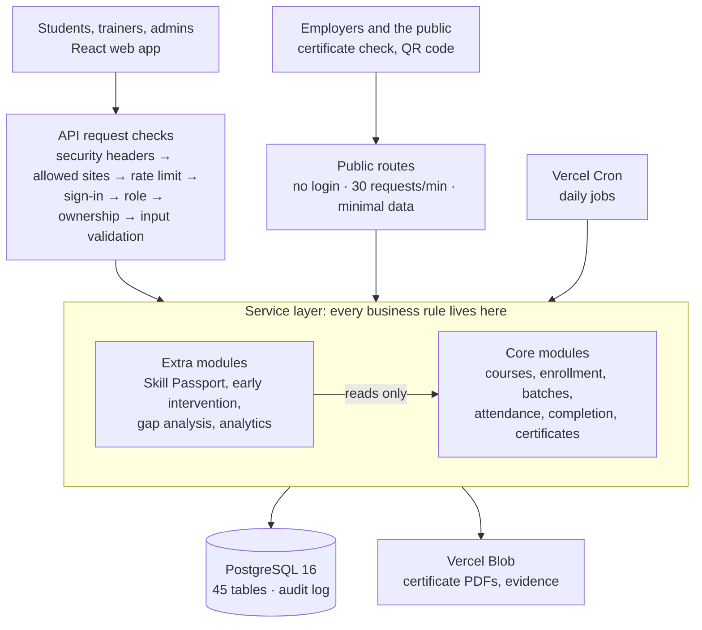

# KISS SkillBridge: Project Report

**Team:** Shashank Singh · Arnav Ambasta
**Live site:** <https://kiss-vtmp.vercel.app>
**Code:** <https://github.com/ShashankSinghhh/kiss-vocational-training>

## 1. Overview

KISS SkillBridge is a web portal that takes every vocational student at the Kalinga Institute of
Social Sciences (KISS) from enrollment to a verifiable certificate and a Skill Passport. It
replaces paper registers and spreadsheets with one rule-driven workflow for students, trainers
and administrators: the system, not a person, decides who has completed a course.

It is live, runs on free hosting, and is ready for KISS to load its real students.

## 2. The problem

Vocational training at KISS runs on spreadsheets, paper registers and informal messages.

| # | Problem | Impact |
| --- | --- | --- |
| P1 | Enrollment and batch allocation done by hand, with no view of seats | Over-filled batches, unfair placement, admin hours lost each cycle |
| P2 | Attendance and marks scattered across registers | Eligibility checks are slow and differ between trainers |
| P3 | Students cannot see their attendance or results | Problems are found only at the end of the course |
| P4 | Certificates issued without a consistent eligibility or authenticity check | Certificates carry little weight with employers; forgery risk |
| P5 | No record of who changed attendance or marks | Disputes cannot be resolved |

## 3. Objectives

Success means one student can travel the whole path from enrollment to a verified certificate
with no offline step.

- Digitize all 12 stages of the training workflow.
- Give each role (student, trainer, admin) its own screens, with every permission checked on
  the server.
- Compute allocation and attendance automatically: an allocation preview for 500 students in
  under 5 seconds.
- Issue certificates only to eligible students, each with a unique ID and a QR code that anyone
  can check in under 3 seconds.
- Flag struggling students within one day of a warning sign.
- Log every sensitive change with its old and new value.

## 4. Users and features

| User | What they do |
| --- | --- |
| Student | Choose a training cycle, a programme and a course; apply; track the application; see their training, attendance and results; download the certificate; share a Skill Passport |
| Trainer | See their batches; take attendance; enter marks; evaluate and recommend students; act on at-risk alerts |
| Admin | Manage users, programmes, courses and cycles; approve applications (or let the rules approve them); run batch allocation; approve completion; revoke certificates; see reports and the audit log |
| Employer / public | Check a certificate by its ID or QR code, without signing in |

**Core workflow:** sign-in and roles · courses grouped into programmes · training cycles with
enrollment windows · applications with automatic approval · batch allocation · sessions and
attendance · assessments and marks · completion and certificates · reports and dashboards ·
notifications.

**What makes it different:**

- **Skill Passport:** a verified record of the skills each student has shown, shareable with
  employers by a link the student controls.
- **Early intervention:** a daily check flags students whose attendance or marks are slipping,
  while there is still time to help.
- **Skill gap analysis:** compares the skills a course requires with those a student has shown,
  and suggests practice.
- **QR certificate check:** any employer confirms a certificate is genuine in seconds.
- **Three languages:** English, Odia and Hindi, and usable on a phone over a slow connection.
- **Audit trail:** every change to attendance, marks, applications and certificates is recorded
  and cannot be edited.

The courses on offer are grouped into five programmes:

| Programme | Courses |
| --- | --- |
| Computer & Digital Skills | Computer Training, IBM Training, Digital Skills Training, Entrepreneurship Training |
| Art, Craft & Handicrafts | Terracotta, Wood Carving, Golden Grass Work, Coir Work, Papier-Mâché, Appliqué Work, Embroidery, Painting, Tribal Art |
| Manufacturing & Production | Apparel Making, Tailoring, Knitting, Chemical Production, Mineral Water Production, Food Processing, Bakery |
| Agriculture & Livelihood | Animal Husbandry, Composite Farming, Pisciculture (Fish Farming), Natural Farming, Renewable Energy |
| Professional & Life Skills | Medical Attendant, Driving, Mahindra Pride Programme, Soft Skills, Entrepreneurial Training |

## 5. How we built it

We wrote the requirements and architecture first, then built the system in 14 short sprints
grouped into three releases, each closed by a gate:

1. **Release 1, core workflow (Sprints 0–7):** project set-up and automated checks; database
   and audit log; sign-in and roles; courses and enrollment; batches and allocation; attendance
   and marks; completion and certificates; reports. **Gate 1:** one student had to complete the
   whole workflow on the live site before any extra feature started.
2. **Release 2, unique features (Sprints 8–10):** skill model and gap analysis; Skill Passport
   and QR verification; early intervention and the audit log viewer. **Gate 2** passed on
   26 Oct 2026.
3. **Release 3, extras (Sprints 11–13):** smart scheduling, practical evidence uploads, career
   matching, the three languages, outcome analytics and an AI training assistant (built and
   tested, but switched off so the project costs nothing), then hardening.
4. **After release:** two review rounds (a test run of the live site and a review of the rules)
   led to automatic enrollment approval, students choosing their own training cycle, a public
   front page, programmes, a clean database and the final name.

Every sprint ended with the same checklist: all checks and tests pass, new API endpoints are
documented, demo data is updated, all text is translatable, and the sprint log records what was
built.

## 6. Requirements

The Business Requirements Document ([BRD.md](BRD.md)) holds 20 features, 28 business rules and
14 quality requirements, each with an ID that the code and tests refer to.

**Key business rules:**

| Rule | What it says |
| --- | --- |
| BR-01 | One active application per student per training cycle |
| BR-02 | Applications only while the course's enrollment window is open |
| BR-03 | A batch never goes over capacity; extra approved students are waitlisted |
| BR-06 | Attendance can be changed for 48 hours, then only by an admin with a reason |
| BR-08 | Attendance % = sessions attended ÷ sessions held × 100 |
| BR-09 | Completion needs attendance ≥ 75 %, every session marked, all required assessments, an aggregate ≥ 40 % and the trainer's recommendation |
| BR-10 | A certificate only after admin approval, with a unique, unguessable ID |
| BR-11 | Grades: A ≥ 85 %, B 70–84.99 %, C 55–69.99 %, D 40–54.99 % |
| BR-12 | Every change to attendance, marks, applications or completion is logged |
| BR-15 | The public certificate check never shows marks, attendance or contact details |

These limits (75 %, 40 %, 48 hours and so on) are settings an admin can change, not numbers
fixed in the code.

**Quality requirements (selected):** pages respond within 2 s for 100 users at once; core
student pages stay under 500 KB; status changes are all-or-nothing; the certificate check loads
within 3 s on a phone; every screen works with a keyboard and meets WCAG 2.1 AA contrast.

## 7. Design

The system is one web app, one API and one database, with every business rule kept in one
layer of the API. The architecture is described in full in [TAD.md](TAD.md).



**Design choices:**

- **One deployable app with strict modules** (26 of them) instead of microservices: simpler to
  build, test and host for two people, while each module still owns its own code and tables.
- **Rules in one place:** attendance %, grades, eligibility and risk levels are small functions
  tested at their exact limits (74.99 % vs 75.00 %).
- **Every request passes the same checks** before any rule runs, so a student can never see
  another student's data.
- **All-or-nothing changes:** each status change and its audit record are saved together or not
  at all.
- **Extra features only read the core,** so any of them can be switched off without breaking
  enrollment-to-certificate.

**Main data:** a *Programme* groups *Courses*; a *Training cycle* offers courses through
enrollment windows; a student's *Enrollment* names a course; a *Batch* runs one course in one
cycle, with its students, trainers, *Sessions* (attendance) and *Assessments* (marks); a
*Certificate* records the result and carries the public code for the QR. The database has 45
tables; see [ER.md](ER.md).

**Student journey:** choose a cycle → choose a programme → choose a course → apply → approved
(automatically when the rules are met) → placed in a batch → train → complete → certificate.

## 8. Technology

| Part | Technology |
| --- | --- |
| Web app | React 18, Vite, Tailwind CSS, TanStack Query, React Hook Form, i18next (English, Odia, Hindi) |
| API | Node.js 20, Express, Zod, Prisma, JWT sign-in, bcrypt, PDFKit and QR codes |
| Database | PostgreSQL 16 |
| Hosting | Vercel (web and API), Neon (database), Vercel Blob (files), all on free plans |
| Testing | Jest and Supertest (API), Playwright and axe-core (browser and accessibility), k6 and Lighthouse (performance) |
| Automation | GitHub Actions runs every check on every push and deploys the main branch |

The code is about 37,000 lines of TypeScript, with about 11,700 lines of tests.

## 9. Testing

All 491 API tests and 79 browser tests pass, and every one of the 120 requirements and business
rules is covered by at least one test ([TRACEABILITY.md](TRACEABILITY.md)).

| Level | What it checks |
| --- | --- |
| Unit | Each rule at its limits: attendance, grades, eligibility, risk levels, allocation order |
| Integration | Every API endpoint against a real database: sign-in, roles, ownership, validation, saving, audit records |
| Security | All 173 routes: each refuses a missing sign-in, the wrong role and other users' data |
| Browser | Real journeys on a desktop and a phone, from application to certificate |
| Accessibility | Every page of every role: no serious accessibility issue |
| Performance | 100 users at once; the certificate check on a slow phone connection |
| Live | The Gate 1 and Gate 2 journeys run against the deployed site |

| Result | Value |
| --- | --- |
| API tests | 491, all passing |
| Browser tests (desktop and phone) | 79, all passing |
| Code covered by API tests | about 90 % of lines |
| Certificate check page on a phone | Lighthouse score 100, loads in 0.9 s, 11 KB |
| Live site response | 0.4–0.6 s; 2.7 s for the first request after it has been idle |

Before submission we also clicked through every page as each user, in English, Odia and phone
size (95 page visits), and ran a full back-and-forth journey on the real course data. It found
one problem (a duplicate programme name showed a vague error message), which we fixed the same
day.

## 10. Security and quality

- Passwords are stored hashed; sign-in uses short-lived tokens; an account locks after 5 wrong
  passwords.
- Every request is checked for role and ownership on the server; the security tests prove it for
  every route.
- Public pages show the minimum (name, course, grade, date, status) and are rate-limited.
- Every sensitive change is in an audit log that the database itself prevents from being edited.
- Every push runs lint, type checks, translation and traceability checks, all tests, the
  production build and a page-size budget, then a smoke test of the live site.

## 11. Timeline, team and risks

```mermaid
gantt
    title Build and release schedule, 2026
    dateFormat YYYY-MM-DD
    axisFormat %b %d
    section Build
    Release 1: core (Sprints 0–7)       :r1, 2026-10-19, 2026-10-23
    Gate 1: one student end to end      :milestone, g1, 2026-10-23, 0d
    Releases 2–3 (Sprints 8–13)         :r23, 2026-10-23, 2026-10-26
    Gate 2: unique features             :milestone, g2, 2026-10-26, 0d
    section After release
    Review rounds and improvements      :post, 2026-10-27, 2026-11-04
    Report and presentation             :rep, 2026-11-04, 2026-11-07
```

The requirements and architecture documents were written before the build started.

| Member | Main work |
| --- | --- |
| Shashank Singh | Requirements and architecture, core workflow and most modules, deployment, programmes, clean data and naming |
| Arnav Ambasta | Security review and fixes, automation of admin tasks, demo data and admin-password tools |

| Risk | What we did | Outcome |
| --- | --- | --- |
| Too many features for two people | Froze the core first; extras only after Gate 1 | Core finished first; AI assistant left switched off |
| Not enough testing time | Wrote tests with every feature | 570 tests, all requirements covered |
| Public pages leak personal data | Minimal fields, random codes, rate limits, security tests | Checked on the live site |
| Costs | Free plans only | Running cost is zero |
| Translations not accurate | All text kept outside the code | Native Odia and Hindi review still to do |

## 12. Deployment

| Part | Where it runs |
| --- | --- |
| Web app and API | Vercel (Singapore region) |
| Database | Neon PostgreSQL 16 (Singapore) |
| Certificate PDFs and evidence files | Vercel Blob |
| Daily jobs (risk check, reminders, closing finished batches) | Vercel Cron |

Every push to the main branch is tested and deployed automatically. The live database starts
clean: 5 programmes, 30 courses, one training cycle open for applications, one batch per course
with its trainer, and 100 students. See [DEPLOYMENT.md](DEPLOYMENT.md).

## 13. Results and next steps

**Delivered:** the full enrollment-to-certificate workflow, the Skill Passport, early
intervention, gap analysis, QR verification, three languages and phone support, live at
<https://kiss-vtmp.vercel.app>.

**Known limits:**

- The first request after the site has been idle takes about 2.7 s (free hosting).
- The Odia and Hindi text still needs a review by native speakers.

**Next steps:**

- Load KISS's real students and trainers.
- Native-language review of the translations.
- Switch on the AI training assistant if KISS approves a budget.
- Move to a paid plan if the first-request delay matters in daily use.

## 14. Conclusion

SkillBridge turns a paper-based process into one clear, audited workflow: students see their
progress as it happens, trainers record it once, the system applies the rules the same way for
everyone, and every certificate can be checked by anyone in seconds.

## More documents

[User guide](USER_GUIDE.md) · [Demo script](DEMO.md) · [Requirements (BRD)](BRD.md) ·
[Architecture (TAD)](TAD.md) · [Database](ER.md) · [Test plan](TEST_PLAN.md) ·
[Traceability](TRACEABILITY.md) · [Deployment](DEPLOYMENT.md) · [Sprint log](PROGRESS.md)
